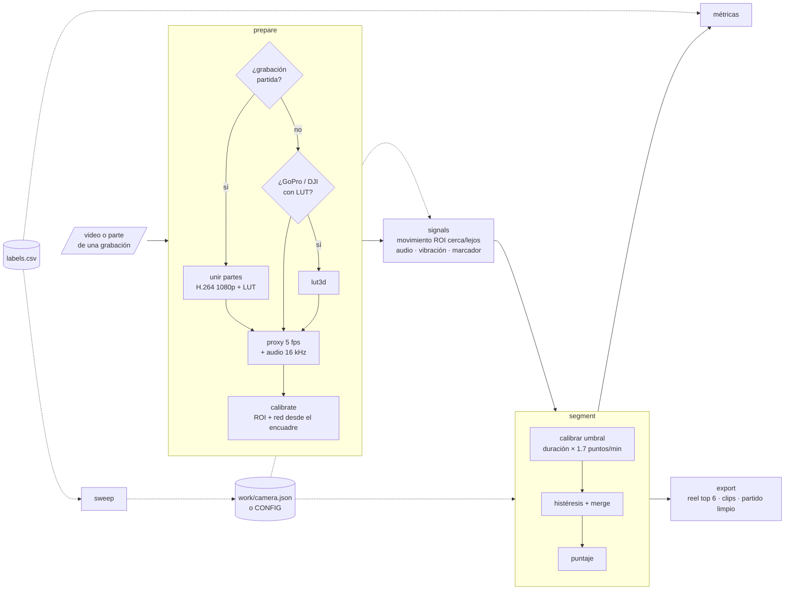

# RallycutPa

Detecta los rallies de un partido de pádel grabado con cámara fija y arma un reel con los mejores puntos. Decisiones y hallazgos: [`docs/brainstorm.md`](docs/brainstorm.md).

## Quick start

Requisito: Docker corriendo.

```sh
mkdir -p media/<date> && cp ~/Movies/partido.mp4 media/<date>/game.mp4
scripts/highlights media/<date>/game.mp4
```

Un solo comando hace todo:

1. Construye la imagen si falta.
2. Une los archivos si la cámara partió la grabación.
3. Detecta la cámara y aplica el LUT.
4. Saca la config de cámara del encuadre.
5. Detecta y puntúa los rallies, y exporta el reel.

Tarda unos 3–4 min por cada 20 min de video. Al final imprime dónde quedaron `reel_top.mp4` y `calibration.jpg`, la imagen para revisar el polígono de la cancha.

| Variante                                | Comando                                                            |
| --------------------------------------- | ------------------------------------------------------------------ |
| También clip por rally y partido limpio | `scripts/highlights VIDEO --all`                                   |
| Audio en un archivo aparte              | `scripts/highlights VIDEO AUDIO`                                   |
| Forzar una config de cámara             | `CONFIG=config/camera-outside-glass.json scripts/highlights VIDEO` |

**Un video a la vez.** Se procesa una grabación por carpeta (`media/<date>/`) y por ejecución; todavía no hay procesamiento en lote. El video tiene que estar dentro del repo, porque Docker solo ve esta carpeta (`media/` está en `.gitignore`).

**Grabaciones partidas.** Las cámaras cortan las grabaciones largas en varios archivos. Pasa cualquiera de ellos, y `prepare` encuentra el resto:

- **GoPro**: por el nombre (`GH01xxxx`, `GH02xxxx`…).
- **DJI y otras**: por la metadata. Son partes de la misma grabación si una empieza donde termina la anterior, con el mismo codec y la misma resolución.

Las partes se unen en `work/source.mp4`: H.264 1080p 8-bit, keyframe cada 1 s y LUT ya aplicado. Todo lo que sigue usa ese archivo, y los originales no se tocan.

## Uso por etapas

```sh
scripts/rc all    media/<date>/game.mp4      # prepare (+ calibrate) + signals + segment
scripts/rc export media/<date>/game.mp4      # reel top 6
```

- Las salidas quedan en `media/<date>/work/`: `reel_top.mp4`, `clips/`, `match_clean.mp4`, `segments.csv` (rallies con puntaje), `segments_XX.png` (curvas por tramos de 6 min), `camera.json` y `calibration.jpg`.
- Para ajustar parámetros basta con `segment` + `export`; no hace falta repetir `prepare`.

| Comando                               | Qué hace                                                                                       |
| ------------------------------------- | ---------------------------------------------------------------------------------------------- |
| `probe VIDEO`                         | Codec, resolución, fps, keyframes                                                              |
| `prepare VIDEO [AUDIO]`               | Une las partes, aplica el LUT, genera el proxy de 5 fps y el audio de 16 kHz; calibra si no hay `CONFIG` |
| `calibrate VIDEO`                     | Config de cámara desde el encuadre: `work/camera.json` + `work/calibration.jpg`                |
| `signals VIDEO`                       | Movimiento en el ROI (cerca/lejos), vibración, marcador, audio                                 |
| `segment VIDEO`                       | Rallies, puntaje, métricas y gráficos                                                          |
| `export VIDEO [--all]`                | Reel y clips                                                                                   |
| `sheet VIDEO INICIO_S DUR_S`          | Contact sheet para revisar a ojo                                                               |
| `run VIDEO [AUDIO] [--all]`           | Todo en un paso (lo usa `scripts/highlights`)                                                  |
| `inspect VIDEO` / `sweep VIDEO [TOP]` | Rasgos por etiqueta / mejores parámetros contra `labels.csv`                                   |
| `test [ARGS]`                         | Suite de pruebas (pytest)                                                                      |

## Flujo



Los originales solo se leen en `prepare` y en `export`. Las líneas punteadas son el ciclo de ajuste: etiquetar, medir, barrer parámetros y actualizar la config.

## Detección

1. **Movimiento**: diferencia entre frames del proxy dentro del polígono de la cancha (ROI). Se mide por separado en la mitad cercana y en la lejana, cada una normalizada por su percentil 95, y se promedian con un suavizado de `smooth_s`.
2. **Calibración**: se esperan `minutos × points_per_min` rallies; el valor por defecto es 1.7/min, porque un partido de 1:30 h tiene ≈ 155 puntos. El umbral `on` (con `off = on × off_ratio`) se ajusta hasta acercarse a ese número. Si la config no define `points_per_min`, se usan `on`/`off` fijos.
3. **Histéresis**: el rally empieza al pasar `on` y termina al bajar de `off`. Se unen los tramos separados por menos de `merge_gap_s` y se descartan los que duran menos de `min_len_s`. Opcional: exigir al menos `min_hits` golpes de audio.
4. **Puntaje**: ranking promedio de golpes, duración, pico de movimiento y pico de audio al cierre. El reel toma los `top_n`.

## Métricas

`media/<date>/labels.csv` marca tramos que deben quedar (`rally`) y tramos que no (`dead`):

```csv
start,end,label
2:10,2:30,rally
4:59,5:13,dead
```

| Métrica          | Mide                                                    | Objetivo              |
| ---------------- | ------------------------------------------------------- | --------------------- |
| `reel_precision` | Parte rally de los segundos etiquetados dentro del reel | Alta; es la principal |
| `rally_cov`      | Parte del tiempo `rally` que queda en algún clip        | Alta                  |
| `dead_leak`      | Parte del tiempo `dead` que se cuela                    | Baja                  |

`sweep` ordena por `rally_cov − 2 × dead_leak` y después por `reel_precision`. Con menos de unos 20 tramos por clase, sobreajusta. Si la config define `scoreboard` (videos con marcador superpuesto), cada cambio del marcador también se usa como fin de punto.

## Config de cámara

**Automática (por defecto).** `calibrate` deriva la config del encuadre:

1. Toma la mediana de 7 frames repartidos por el video, para borrar a los jugadores.
2. Toma el color del piso justo frente a la cámara y se queda con la región conectada de ese color. Las canchas vecinas quedan afuera.
3. Busca la cinta blanca de la red.
4. Arma el polígono con espacio arriba para el cuerpo de los jugadores lejanos.

El resultado va a `work/camera.json`, y `work/calibration.jpg` muestra el polígono (amarillo) y la red (rojo). **Revísalo una vez por cámara nueva.** Si está mal, copia `camera.json` a `config/`, corrige los puntos y pásalo con `CONFIG=...`.

La config automática toma los parámetros de detección y los LUTs de `config/camera-glass.json`, que funciona como plantilla. En el video de prueba, el polígono automático da los mismos resultados que el dibujado a mano.

Campos (coordenadas en píxeles del original):

- `roi`: polígono de la cancha.
- `net_y`: altura de la red.
- `scoreboard`: zona del marcador superpuesto, o `null`.
- `segment` y `export`: los parámetros de arriba.
- `luts`: LUT por fabricante.

Configs fijas:

- `camera-glass.json`: cámara baja, pegada al vidrio. Es la plantilla.
- `camera-outside-glass.json`: export de RADAR, cámara alta y con marcador.

**Videos en log** (GoPro GP-Log, DJI D-Log M como la Osmo Action 5 Pro): `prepare` detecta el fabricante por la metadata y aplica `luts.<fabricante>`; el original no se toca. Los `.cube` se bajan de la web del fabricante a `luts/` y no se versionan. La metadata no dice si se grabó en log: si la cámara grabó en color normal, quita el LUT de la config.

## Estado (2026-11-12)

En el video de prueba con la cámara pegada al vidrio (11 tramos etiquetados), con la config automática:

- `reel_precision` 88%.
- `rally_cov` 90%.
- `dead_leak` 77%.

El reel funciona razonablemente. El partido limpio todavía no, porque caminar al saque o buscar la pelota se ve igual que jugar. La unión de archivos partidos está probada con clips sintéticos, pero falta validarla con una grabación real de DJI.
