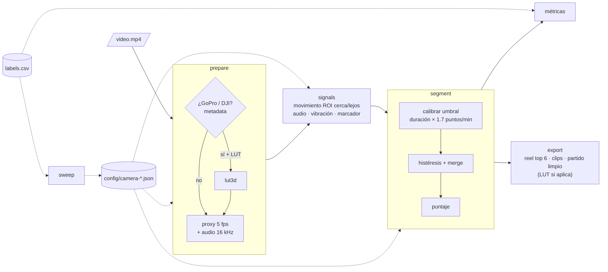

# RallycutPa

Detecta los rallies de un partido de pádel grabado con cámara fija y arma un reel con los mejores puntos. Decisiones y hallazgos: [`docs/brainstorm.md`](docs/brainstorm.md).

## Uso

Requisito: Docker. Primera vez: `docker compose build`.

```sh
export CONFIG=config/camera-glass.json           # config de la posición de cámara
scripts/rc all    media/2026-11-12/game.mp4      # prepare + signals + segment
scripts/rc export media/2026-11-12/game.mp4      # reel top 6 (--all: + clip por rally + partido limpio)
```

- Los videos van en `media/<fecha>/` (ignorado por git). Si el audio viene aparte: `scripts/rc all VIDEO AUDIO`.
- Las salidas quedan en `media/<fecha>/work/`: `reel_top.mp4`, `clips/`, `match_clean.mp4`, `segments.csv` (rallies con puntaje) y `segments_XX.png` (curvas por tramos de 6 min).
- Para ajustar parámetros basta con `segment` + `export`; no hace falta repetir `prepare`.

| Comando | Qué hace |
|---|---|
| `probe VIDEO` | Codec, resolución, fps, keyframes |
| `prepare VIDEO [AUDIO]` | Detecta la cámara, aplica el LUT si corresponde; proxy 640 px @ 5 fps + audio 16 kHz |
| `signals VIDEO` | Movimiento en el ROI (cerca/lejos), vibración, marcador, audio |
| `segment VIDEO` | Rallies, puntaje, métricas y gráficos |
| `export VIDEO [--all]` | Reel y clips |
| `sheet VIDEO INICIO_S DUR_S` | Contact sheet para revisar a ojo |
| `inspect VIDEO` / `sweep VIDEO [TOP]` | Rasgos por etiqueta / mejores parámetros contra `labels.csv` |
| `test [ARGS]` | Suite de pruebas (pytest) |

## Flujo



El original solo se lee en `prepare` y en `export`. Las líneas punteadas son el ciclo de ajuste: etiquetar, medir, barrer parámetros y actualizar la config.

## Detección

1. **Movimiento**: diferencia entre frames del proxy dentro del polígono de la cancha (ROI). Se mide por separado en la mitad cercana y en la lejana, cada una normalizada por su percentil 95, y se promedian con un suavizado de `smooth_s`.
2. **Calibración**: se esperan `minutos × points_per_min` rallies; el valor por defecto es 1.7/min, porque un partido de 1:30 h tiene ≈ 155 puntos. El umbral `on` (con `off = on × off_ratio`) se ajusta hasta acercarse a ese número. Si la config no define `points_per_min`, se usan `on`/`off` fijos.
3. **Histéresis**: el rally empieza al pasar `on` y termina al bajar de `off`. Se unen los tramos separados por menos de `merge_gap_s` y se descartan los que duran menos de `min_len_s`. Opcional: exigir al menos `min_hits` golpes de audio.
4. **Puntaje**: ranking promedio de golpes, duración, pico de movimiento y pico de audio al cierre. El reel toma los `top_n`.

## Métricas

`media/<fecha>/labels.csv` marca tramos que deben quedar (`rally`) y tramos que no (`dead`):

```csv
start,end,label
2:10,2:30,rally
4:59,5:13,dead
```

| Métrica | Mide | Objetivo |
|---|---|---|
| `reel_precision` | Parte rally de los segundos etiquetados dentro del reel | Alta; es la principal |
| `rally_cov` | Parte del tiempo `rally` que queda en algún clip | Alta |
| `dead_leak` | Parte del tiempo `dead` que se cuela | Baja |

`sweep` ordena por `rally_cov − 2 × dead_leak` y después por `reel_precision`. Con menos de unos 20 tramos por clase, sobreajusta. Si la config define `scoreboard` (videos con marcador superpuesto), cada cambio del marcador también se usa como fin de punto.

## Config de cámara

Un JSON por posición en `config/`, con coordenadas en píxeles del original:

- `roi`: polígono de la cancha, sin las canchas vecinas.
- `net_y`: altura de la red.
- `scoreboard`: zona del marcador superpuesto, o `null`.
- `segment` y `export`: los parámetros de arriba.
- `luts`: LUT por fabricante.

Configs disponibles:

- `camera-glass.json`: cámara baja, pegada al vidrio de fondo. Es el ángulo objetivo.
- `camera-outside-glass.json`: export de RADAR, cámara alta y con marcador.

**Videos en log** (GoPro GP-Log, DJI D-Log M como la Osmo Action 5 Pro): `prepare` detecta el fabricante por la metadata y aplica `luts.<fabricante>` al proxy y a los exports; el original no se toca. Los `.cube` se bajan de la web del fabricante a `luts/` y no se versionan. La metadata no dice si se grabó en log: si la cámara grabó en color normal, quita el LUT de la config.

## Estado (2026-11-12)

En el video de prueba con la cámara pegada al vidrio (11 tramos etiquetados), la calibración automática dio `reel_precision` 89%, `rally_cov` 69% y `dead_leak` 66%. El reel funciona razonablemente. El partido limpio todavía no, porque caminar al saque o buscar la pelota se ve igual que jugar.
