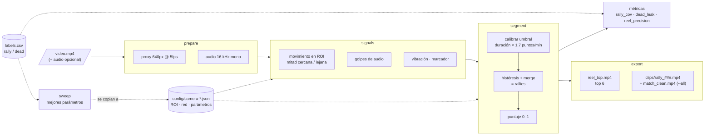

# RallycutPa

Detecta los rallies de un partido de pádel grabado con cámara fija y arma un reel con los mejores puntos. Diseño y decisiones: [`docs/brainstorm.md`](docs/brainstorm.md).

## Requisitos

- Docker (todo corre dentro de la imagen `rallycutpa-tools`: ffmpeg + uv + Python).
- Primera vez: `docker compose build`.

## Uso rápido

1. Copia el video a `media/<fecha>/` (por ejemplo `media/2026-11-12/game.mp4`). `media/` está en `.gitignore`.
2. Elige la config de cámara (ver [Config de cámara](#config-de-cámara)):

   ```sh
   export CONFIG=config/camera-glass.json
   ```

3. Analiza y exporta:

   ```sh
   scripts/rc all    media/2026-11-12/game.mp4            # proxy + señales + rallies + gráficos
   scripts/rc export media/2026-11-12/game.mp4            # reel con los top N
   scripts/rc export media/2026-11-12/game.mp4 --all      # además: clip por rally + partido limpio
   ```

   Si el audio viene en un archivo aparte (alineado con el video): `scripts/rc all VIDEO AUDIO`.

Todo lo generado queda en `media/<fecha>/work/`:

| Archivo | Contenido |
|---|---|
| `reel_top.mp4` | Top N rallies por puntaje, en orden cronológico |
| `clips/rally_###.mp4` | Clips individuales |
| `match_clean.mp4` | Todos los rallies concatenados (`--all`) |
| `segments.csv` | Rallies detectados: inicio, fin, rasgos y puntaje |
| `segments_XX.png` | Curva de actividad por tramos de 6 min, con los rallies sombreados |

## Comandos

```
scripts/rc probe    VIDEO                  codec, resolución, fps, intervalo de keyframes
scripts/rc prepare  VIDEO [AUDIO]          proxy 640px @ 5 fps + audio 16 kHz mono
scripts/rc signals  VIDEO                  rasgos por frame (movimiento, vibración, marcador, audio)
scripts/rc segment  VIDEO                  rallies + puntaje + métricas + gráficos
scripts/rc export   VIDEO [--all]          clips y reel
scripts/rc sheet    VIDEO INICIO_S DUR_S   contact sheet del proxy para revisar a ojo
scripts/rc inspect  VIDEO                  rasgos por intervalo etiquetado (labels.csv)
scripts/rc sweep    VIDEO [TOP]            busca los mejores parámetros contra labels.csv
```

Para tunear los parámetros no hace falta re-correr `prepare` ni `signals`: basta con `segment` y `export`.

## Flujo



El video original solo se lee en `prepare` y `export`; el análisis trabaja siempre sobre el proxy. Las líneas punteadas son el ciclo de tuning: etiquetar, medir, barrer parámetros y actualizar la config.

## Cómo se detecta un rally

1. **Movimiento en el ROI**: diferencia entre frames consecutivos del proxy, dentro del polígono de la cancha. Se mide por separado en la mitad cercana y en la lejana (la cercana ocupa muchos más píxeles), y cada una se normaliza por su percentil 95.
2. **Actividad** = promedio de ambas mitades, suavizado `smooth_s` segundos.
3. **Calibración automática**: se esperan `duración_min × points_per_min` rallies (por defecto 1.7/min, derivado de un partido de 1:30 h ≈ 155 puntos). El umbral `on` se elige para que la cantidad detectada se acerque a ese número, con `off = on × off_ratio`. Si la config no tiene `points_per_min`, se usan `on`/`off` fijos.
4. **Histéresis**: el rally empieza cuando la actividad supera `on` y termina cuando baja de `off`. Los tramos separados por menos de `merge_gap_s` se unen; los más cortos que `min_len_s` se descartan. Si `min_hits` > 0, se exige además ese mínimo de golpes de audio.
5. **Puntaje** (0–1): promedio de los rankings de golpes de audio, duración, pico de movimiento y pico de audio en los 3 s posteriores (festejo). El reel toma los `top_n` (por defecto 6).

## Métricas

### Contra etiquetas manuales (`labels.csv`)

`media/<fecha>/labels.csv`, junto al video:

```csv
start,end,label
2:10,2:30,rally
4:59,5:13,dead
```

- `rally`: tramo que debe quedar. `dead`: tramo que no debe quedar (caminar al saque, buscar la pelota).
- **rally_cov**: porcentaje de segundos `rally` que quedan dentro de algún clip (con padding). Más alto es mejor.
- **dead_leak**: porcentaje de segundos `dead` que se colaron en algún clip. Más bajo es mejor.
- **reel_precision**: de los segundos etiquetados que caen dentro del reel (top N), qué parte es `rally`. Es la métrica principal para highlights.
- **kept**: porcentaje del video total que queda en rallies.

`scripts/rc sweep` prueba combinaciones de `points_per_min`, `off_ratio`, `smooth_s`, `merge_gap_s`, `min_len_s` y padding, y ordena por `rally_cov − 2 × dead_leak` (y después por `reel_precision`). Los valores elegidos se copian a la config de cámara.

Con pocas etiquetas, el sweep sobreajusta. Conviene etiquetar al menos 20 intervalos de cada tipo, repartidos por todo el partido.

### Contra el marcador (solo videos con overlay)

Si la config define `scoreboard`, cada cambio del marcador se toma como fin de punto. Se reporta qué porcentaje de rallies termina 1–10 s antes de un cambio (precisión) y qué porcentaje de cambios tiene un rally que termina justo antes (recall).

## Config de cámara

Un JSON por posición de cámara en `config/` (coordenadas en píxeles del video original):

- `roi`: polígono de la cancha. Excluye las canchas vecinas visibles por los costados.
- `net_y`: altura de la red; separa la mitad cercana de la lejana.
- `scoreboard` / `board_threshold`: zona del marcador superpuesto, o `null`.
- `segment`: parámetros de detección (ver arriba): `points_per_min`, `off_ratio`, `smooth_s`, `merge_gap_s`, `min_len_s`, `min_hits`. Opcional: `on`/`off` fijos, sin `points_per_min`.
- `export`: `pad_before_s`, `pad_after_s`, `top_n`.
- `luts`: LUT por fabricante (`gopro`, `dji`) para videos grabados en log. Ver abajo.

### Videos en log (GoPro GP-Log, DJI D-Log M)

`prepare` lee la metadata del contenedor para saber el fabricante (GoPro o DJI; si no lo reconoce, `unknown`). Si la config tiene un LUT para ese fabricante y el archivo existe, el LUT se aplica:

- al **proxy de análisis**: el log tiene poco contraste y sin LUT se detecta menos movimiento;
- a los **exports** (reel y clips), que ya se reencodean.

El original no se toca. Los `.cube` no se versionan: se descargan de la web oficial del fabricante y se guardan en `luts/` con el nombre que indique la config (`luts/dji-dlogm.cube`, `luts/gopro-gplog.cube`). Si falta el archivo, se avisa y se sigue sin conversión.

La metadata solo dice el fabricante, no el perfil de color. Si esa cámara grabó en color normal, hay que quitar el LUT de la config, porque aplicarle un LUT de log lo deja sobresaturado. `scripts/rc prepare` muestra la cámara y el LUT que usó.

Configs actuales:

- `camera-glass.json`: cámara baja pegada al vidrio de fondo (ángulo objetivo).
- `camera-outside-glass.json`: export de RADAR con marcador (cámara alta, fuera del vidrio).

## Estado (2026-11-12)

En el video de prueba de cámara pegada al vidrio (11 tramos etiquetados):

| Config | rally_cov | dead_leak | reel_precision (top 6) |
|---|---|---|---|
| Umbral fijo sensible | 100% | 99% | — |
| Umbral fijo estricto | 41% | 10% | — |
| **Auto 1.7 puntos/min (actual)** | 69% | 66% | **89%** |

El reel de highlights funciona razonablemente. El partido limpio todavía no: caminar al saque o buscar la pelota se ve igual que jugar. Hallazgos y próximos pasos en [`docs/brainstorm.md`](docs/brainstorm.md).
